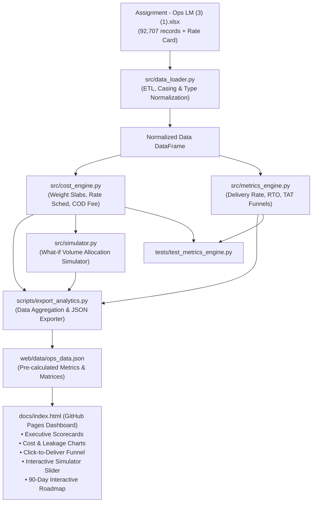

# System Architecture: BlissClub Last Mile Operations Intelligence

## Status: FROZEN

---

## 1. System Overview & Component Layout
The system is built as a modular data engineering, financial modeling, and decision intelligence suite. It ingests the raw transactional logs and rate cards, executes mathematical normalization, computes unit economics and SLAs, and exports optimized JSON data consumed by the GitHub Pages web dashboard.



---

## 2. Directory Layout
```
BlissClubTask/
├── .gitignore
├── agent.md                          # Repository instructions and agreed postures
├── Assignment - Ops LM (3) (1).xlsx  # Raw source data
├── docs/                             # Living documentation suite & GitHub Pages root
│   ├── README.md                     # Docs index
│   ├── PROJECT_MENTAL_MODEL.md       # Operational mental model
│   ├── PROJECT_STATUS.md             # Milestone progress checklist
│   ├── SPEC.md                       # Functional requirements & acceptance criteria
│   ├── ARCHITECTURE.md               # Technical architecture & formulas
│   ├── DECISIONS.md                  # Architectural Decision Records (ADRs)
│   ├── TASKS.json                    # Ordered implementation tasks
│   ├── EXECUTIVE_MEMO.md             # Board-ready answers to Q1-Q6
│   └── index.html                    # GitHub Pages interactive web application
├── src/                              # Core Python engine
│   ├── __init__.py
│   ├── data_loader.py                # Fast data ingestion and cleaning
│   ├── cost_engine.py                # Rate card pricing and weight slab logic
│   ├── metrics_engine.py             # TAT funnels, SLA breach and RTO metrics
│   └── simulator.py                  # Volume reallocation what-if simulation
├── tests/                            # Automated verification suite
│   ├── __init__.py
│   ├── test_cost_engine.py           # Unit tests for weight slabs and rate formulas
│   └── test_metrics_engine.py        # Unit tests for delivery rates and TAT
└── scripts/                          # Automation scripts
    └── export_analytics.py           # Pipeline runner & JSON exporter for web app
```

---

## 3. Mathematical & Business Formulas

### 3.1 Billable Weight & Slab Sizing
For any actual weight $W$ in kg:
$$\text{Billable Slabs} = \lceil \frac{W}{0.5} \rceil$$
$$\text{Base Freight} = \text{Rate}_{\text{First 500g}}(\text{Aggregator}, \text{Zone})$$
$$\text{Additional Freight} = (\text{Billable Slabs} - 1) \times \text{Rate}_{\text{Addnl 500g}}(\text{Aggregator}, \text{Zone})$$

### 3.2 Total Cost per AWB
$$\text{Freight Cost} = \text{Base Freight} + \text{Additional Freight}$$
$$\text{COD Surcharge} = 
\begin{cases} 
\text{COD Flat Fee}(\text{Aggregator}), & \text{if Order Type} = \text{'COD'} \\ 
0, & \text{if Order Type} = \text{'PrePaid'} 
\end{cases}$$
$$\text{Total Cost per AWB} = \text{Freight Cost} + \text{COD Surcharge}$$

### 3.3 Funnel Lead Times
$$\text{Warehouse TAT} = \text{AWB Assignment Time} - \text{Order Date}$$
$$\text{Handover TAT} = \text{Pickup Date} - \text{AWB Assignment Time}$$
$$\text{Transit TAT} = \text{Delivered Date} - \text{Pickup Date}$$
$$\text{Click-to-Deliver TAT} = \text{Delivered Date} - \text{Order Date}$$

---

## 4. Expensive to Change (Technical & Operational Boundaries)
1. **Per-AWB Billing Unit:** The rate card strictly states *"Charges are applicable on an Airway Bill (AWB)"*. An Order ID with multiple AWBs incurs separate freight charges per AWB.
2. **Pre-Computed Web Data Pipeline:** The GitHub Pages website relies on pre-computed JSON exports rather than dynamic Python web servers. If data changes, `python scripts/export_analytics.py` must be re-run to refresh `docs/data/ops_data.json`.
3. **Contract Rate Slabs:** Changing courier rates requires updating the rate matrix in `src/cost_engine.py`.

---

## 5. Setup & Verification Requirements
- Python 3.11+ (Python 3.13 verified on environment).
- Required libraries: `pandas`, `openpyxl`, `pytest`.
- Full test command: `pytest tests/ -v`
- Analytics export command: `python scripts/export_analytics.py`
